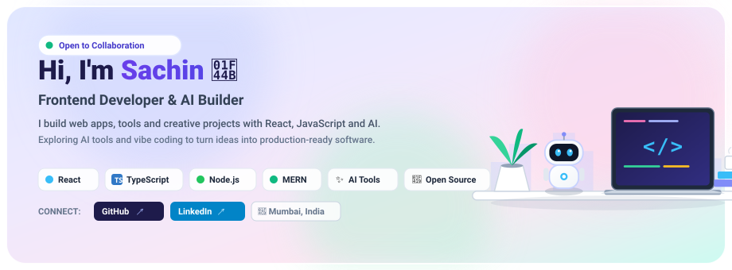

<div align="center">

<!-- Aurora Pastel Hero Banner -->


<br /><br />

<!-- Quick Connect & Location Badges in Aurora Pastel Accents -->
<a href="https://www.linkedin.com/in/sachin-mane-27b14665/"></a>
&nbsp;
<a href="https://github.com/mumbaimerijaan"></a>
&nbsp;
<a href="https://www.google.com/maps/place/Mumbai"></a>
&nbsp;
<a href="https://www.linkedin.com/in/sachin-mane-27b14665/"></a>

</div>

---

### 🔮 About Me

```yaml
name: Sachin
title: Frontend Developer & AI Builder
experience: 19+ years
stack: [React, TypeScript, Node.js, MERN, AI Tools]
location: Mumbai, India
philosophy: "Turning creative ideas into fast, elegant, production-ready software with AI-assisted vibe coding."
```

- 🚀 **Background:** Full Stack Developer with 19+ years building enterprise web apps and consumer digital products.
- 🛠️ **Current Focus:** AI tools exploration, interactive media, MERN architecture, and rapid prototyping.
- 🎓 **Education:** Diploma in Man-Made Textile Technology (DMMTT).
- 🤝 **Collaboration:** Open to innovative frontend architecture, AI-assisted development, and developer tooling projects.

---

### 🎨 Tech Stack & Tools

<p align="center">
  
</p>

<p align="center">
  <sub><b>Frontend:</b> React • TypeScript • JavaScript • TailwindCSS • HTML5 • CSS3</sub> &nbsp;|&nbsp; 
  <sub><b>Backend & Cloud:</b> Node.js • MongoDB • Python • Docker • AWS • Figma</sub>
</p>

---

### 💎 Flagship Projects

<table>
  <tr>
    <td width="33%" valign="top">
      <h4 align="center"><b>InfoSanchay</b></h4>
      <p align="center">
        <a href="https://github.com/mumbaimerijaan/InfoSanchay">
          
        </a>
      </p>
      <p align="center">Save, organize and find links, notes, and resources in one clean workspace.</p>
      <p align="center">
        <code>React Native</code> <code>Expo</code> <code>Airtable</code><br />
        ⭐ 128 • 🍴 19
      </p>
      <p align="center"><a href="https://github.com/mumbaimerijaan/InfoSanchay"><b>View Repository →</b></a></p>
    </td>
    <td width="33%" valign="top">
      <h4 align="center"><b>Svamaya.in</b></h4>
      <p align="center">
        <a href="https://svamaya.in">
          
        </a>
      </p>
      <p align="center">Print-On-Demand eCommerce brand for custom apparel and lifestyle merchandise.</p>
      <p align="center">
        <code>Next.js</code> <code>Razorpay</code> <code>POD</code><br />
        ⭐ 76 • 🍴 11
      </p>
      <p align="center"><a href="https://svamaya.in"><b>Live Demo →</b></a> • <a href="https://github.com/mumbaimerijaan/svamaya"><b>Repo</b></a></p>
    </td>
    <td width="33%" valign="top">
      <h4 align="center"><b>Nuxt SaaS Starter</b></h4>
      <p align="center">
        <a href="https://github.com/mumbaimerijaan/ProfileForge">
          
        </a>
      </p>
      <p align="center">Production-ready SaaS boilerplate designed to launch scalable web apps in days.</p>
      <p align="center">
        <code>Nuxt 3</code> <code>TypeScript</code> <code>SaaS</code><br />
        ⭐ 210 • 🍴 32
      </p>
      <p align="center"><a href="https://github.com/mumbaimerijaan/ProfileForge"><b>View Repository →</b></a></p>
    </td>
  </tr>
</table>

---

### 📊 GitHub Activity & Metrics

<div align="center">

<!-- Aurora Pastel Styled Stats Cards -->


<br /><br />


</div>

---

<div align="center">

> *"The very best technology never has as much impact as girlfriend or boyfriend trouble."*
> 
> — **Tom DeMarco** *(Wisdom)*

<br />

<sub>Designed with the <b>Aurora Pastel</b> theme preset in <a href="https://github.com/mumbaimerijaan/ProfileForge">ProfileForge</a></sub>

</div>
